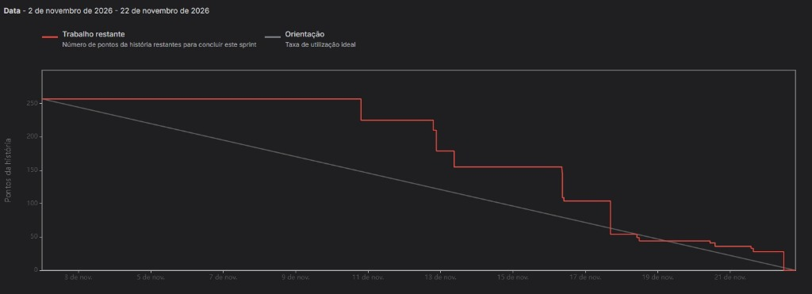

# API 6º Semestre ADS — Gestão de Regras

## Documentação — Sprint 3

  

<h2 align="center">Bug Busters</h2>

  <a href="#desafio">Desafio</a> |
  <a href="#goal">Sprint Goal</a> |
  <a href="#us">User Stories</a> |
  <a href="#bdd">Critérios de Aceitação (BDD)</a> |
  <a href="#entregas">Entregas Técnicas por Frente</a> |
  <a href="#dor">DoR</a> |
  <a href="#dod">DoD</a> |
  <a href="#burndown">Burndown</a> |
  <a href="#equipe">Equipe</a>

> **Status da Sprint:** Concluída  
> **Previsão de entrega:** 22/11/2026  
> **Data de início:** 02/11/2026  
> **Cliente:** Dom Rock  
> **Instituição:** Fatec São José dos Campos — ADS, 6º semestre (2026-2)

[Voltar ao README](../README.md)

---

## 🏅 Desafio e Dor do Negócio 

Consolidar a maturidade operacional, a governança corporativa e a inteligência analítica da plataforma **ComissionAI** para uso em ambiente produtivo pela **Dom Rock**. Após estruturar o motor determinístico na Sprint 1 e a simulação com *Explainable AI* na Sprint 2, o desafio da Sprint 3 foi fechar o ciclo completo de controle preventivo, segurança de acesso e prestação de contas:

1. **Detecção preventiva de desvios operacionais:** identificar automaticamente anomalias estatísticas (outliers) nas vendas diárias por colaborador sem depender de revisão manual exaustiva nem alterar lançamentos originais;
2. **Apoio objetivo à decisão orçamentária:** quando uma simulação exceder o teto previsto, oferecer calibrações matemáticas verificadas por reexecução em sandbox, eliminando tentativas empíricas de ajuste de taxas;
3. **Fechamento gerencial e transparência contábil:** entregar relatórios consolidados por colaborador, regra e competência com exportação oficial em CSV, suportados pela execução determinística do programa Python aprovado;
4. **Rastreabilidade ponta a ponta e Segregação de Funções (SoD):** garantir autenticação, controle de acesso por perfis (RBAC), histórico permanente de cargas, trilha geral de auditoria com correlação entre serviços e esteira formal de revisão técnica e gerencial.

---

## 🎯 Meta da Sprint (Sprint Goal) 

Finalizar o ciclo completo de governança, inteligência preventiva e fechamento gerencial da plataforma ComissionAI, priorizando as **User Stories 10, 11, 12 e 13** como núcleo da entrega:
1. **Detecção de Anomalias Estatísticas (US 10):** Alertar o Auditor de Compliance sobre outliers nas vendas diárias de colaboradores por grupo comparável (Marca × Cargo via IQR de Tukey), com visualização dedicada na Home e nas campanhas, reprocessamento por lote e proteção contra alertas duplicados;
2. **Calibração Orçamentária Verificada e Execução do Programa Python (US 11):** Oferecer ao Head Comercial sugestões determinísticas de calibração de parâmetros sempre que os cenários simulados ultrapassarem o teto orçamentário, com verificação por reexecução em sandbox e suporte ao versionamento e aprovação técnica do programa Python;
3. **Relatórios Consolidados de Fechamento e Apuração Definitiva (US 12):** Disponibilizar ao Gerente de Vendas relatórios consolidados de fechamento por competência, colaborador e regra — com detalhamento de impedimentos e exportação oficial em CSV — além do bloqueio visual e operacional de competências liquidadas;
4. **Auditoria Geral, Histórico Permanente de Cargas e RBAC/SoD (US 13):** Permitir ao Administrador de TI consultar e exportar a trilha completa de auditoria, logs por usuário e histórico permanente de cargas, sustentados por autenticação, gerenciamento de usuários por perfil, segregação de funções (SoD) e indicadores reais na Home.

---

## 📋 User Stories e Critérios de Aceitação 

### US 10 — Detecção de Anomalias Estatísticas em Vendas Diárias (Outliers)
> **Como** Auditor de Compliance,  
> **quero** ser alertado quando houver anomalias nas vendas diárias de um colaborador (outliers estatísticos),  
> **para** realizar verificação preventiva antes da liquidação das comissões.
* **Story Points:** 8 | **Prioridade:** Média | **Status:** Concluído
* **Critérios de Aceitação:**
  * Agregar vendas por colaborador e dia, comparando cada total com o grupo comparável de mesma Marca e Cargo por meio do método estatístico **IQR de Tukey** (sem uso de LLM e sem alterar registros de vendas).
  * Persistir os alertas em banco de dados com proteção de unicidade (evitando alertas duplicados em reprocessamentos ou execuções concorrentes) e preservação do identificador entre reanálises.
  * Exibir card resumo de alertas estatísticos na Home (com indicador de novos casos) e seção detalhada de anomalias na tela da campanha.
  * Permitir o reprocessamento da análise por lote/competência com validação de permissões (SoD) e modal de confirmação.
* **Cenário de Teste (BDD):**
  * **Dado** que uma competência possui vendas diárias efetivadas para colaboradores de uma mesma Marca e Cargo, incluindo um lançamento diário muito acima do limite superior do IQR do grupo;
  * **Quando** a análise de anomalias estatísticas for executada (`POST /api/v2/anomalias/analisar` / `POST /api/v1/alertas-estatisticos/reprocessar`);
  * **Então** o sistema deve registrar o alerta estatístico apontando o colaborador, a data, o valor observado e a faixa esperada do grupo;
  * **E** exibir o alerta para conferência preventiva do Auditor de Compliance sem modificar ou excluir a venda original.

---

### US 11 — Sugestões de Calibração Orçamentária Verificadas em Simulação
> **Como** Head Comercial,  
> **quero** receber sugestões de ajuste de parâmetros caso a simulação estoure o teto orçamentário previsto,  
> **para** adequar a campanha ao orçamento disponível com base em números verificáveis antes da aprovação.
* **Story Points:** 5 | **Prioridade:** Baixa | **Status:** Concluído
* **Critérios de Aceitação:**
  * Comparar os quatro cenários projetados (80%, 100%, 120% e 150%) contra o orçamento informado para a campanha, isolando vendas em conflito também do custo contratual.
  * Quando um cenário ultrapassar o orçamento, calcular sugestões de calibração apenas sobre as regras que efetivamente pagaram comissão naquele cenário.
  * Reexecutar cada calibração sugerida no sandbox Python para comprovar matematicamente o enquadramento ao teto, acompanhada de explicação numérica determinística (sem LLM).
  * Permitir ao operador revisar e aplicar uma calibração verificada diretamente na simulação (`POST /api/v1/simulacoes/{id}/calibracoes/aplicar`), mantendo rastreabilidade das alterações.
* **Cenário de Teste (BDD):**
  * **Dado** que uma campanha com teto orçamentário definido executa a simulação Python e o cenário de 120% excede o orçamento previsto;
  * **Quando** o motor de simulação concluir a análise orçamentária e gerar as calibrações verificadas;
  * **Então** o sistema deve exibir o desvio financeiro, a explicação numérica de cada cenário e as opções de calibração comprovadas por reexecução;
  * **E** ao aplicar uma calibração sugerida, as regras da proposta devem ser atualizadas de forma auditável exigindo nova validação antes da publicação.

---

### US 12 — Relatório Consolidado de Fechamento e Exportação Oficial
> **Como** Gerente de Vendas,  
> **quero** emitir o relatório consolidado de fechamento detalhando resultados por canal, equipe, colaborador e regra,  
> **para** acompanhar o desempenho da operação e auditar os valores liquidados na competência.
* **Story Points:** 5 | **Prioridade:** Média | **Status:** Concluído
* **Critérios de Aceitação:**
  * Disponibilizar o fluxo completo de fechamento de competência na interface (`CompetenceClosingModal` e `CompetenceClosingStatusCard`) e marcar competências encerradas com selo de **Liquidada**, bloqueando novas mutações.
  * Consolidar os resultados da apuração definitiva e do fechamento em abas dedicadas por **Colaborador** e por **Regra**, além da listagem de impedimentos persistidos do fechamento (`tb_impedimentos_fechamento`).
  * Permitir a exportação oficial dos relatórios em formato **CSV** tanto pelo fechamento da competência (`GET /api/v1/comissoes/fechamento/{competencia}/relatorio/exportar`) quanto pela apuração definitiva da campanha (`GET /api/v1/campanhas/{id}/apuracao-definitiva/exportar`).
* **Cenário de Teste (BDD):**
  * **Dado** que uma competência foi apurada e fechada formalmente no sistema;
  * **Quando** o Gerente de Vendas acessar o relatório de fechamento da competência ou da campanha;
  * **Então** a interface deve exibir os consolidados por colaborador, por regra e os impedimentos registrados;
  * **E** ao acionar a exportação CSV, o sistema deve gerar o download do arquivo oficial contendo os valores liquidados e o protocolo do fechamento.

---

### US 13 — Auditoria Geral, Histórico Permanente de Cargas e Controle de Acesso
> **Como** Administrador de TI,  
> **quero** consultar os históricos de envios, validações e ações do sistema,  
> **para** auditar o ciclo de carga, a integridade das bases e a governança de acessos.
* **Story Points:** 3 | **Prioridade:** Média | **Status:** Concluído
* **Critérios de Aceitação:**
  * Persistir de forma permanente o histórico de cargas de planilhas e os registros de auditoria geral de ações (`tb_auditoria_geral`), vinculando autor, perfil, entidade afetada, protocolo e `X-Correlation-Id`.
  * Disponibilizar tela dedicada de **Auditoria** (`/auditoria`) com filtros por usuário, entidade, protocolo e resumo gerencial, além de exportação em CSV (`GET /api/v1/auditoria/exportar`).
  * Proteger rotas e ações por autenticação real (`AuthController`) e perfis de usuário (RBAC), com tela de **Gerenciamento de Usuários** (`/gerenciamento`), **Meu Perfil** (`/perfil`) e políticas estritas de Segregação de Funções (SoD).
  * Integrar a tela inicial (`Home`) com indicadores reais vindos do backend (`GET /api/v1/indicadores`) e ações contextualizadas conforme o perfil autenticado.
* **Cenário de Teste (BDD):**
  * **Dado** que usuários com diferentes perfis realizam cargas de bases, edições de regras, revisões de código Python e fechamentos de competência;
  * **Quando** o Administrador de TI acessar a tela de Auditoria e consultar os registros ou o histórico permanente de cargas;
  * **Então** o sistema deve apresentar cada evento com data/hora, usuário responsável, perfil, protocolo e entidade relacionada;
  * **E** impedir que usuários sem a permissão correspondente acessem rotas restritas ou executem ações conflitantes na esteira de aprovação (SoD).

---

**Total entregue na Sprint 3: 21 Story Points.**

---

## 🧪 Critérios de Aceitação e Refinamento Técnico 

**Cenário 1: Detecção determinística de outliers diários sem duplicidade (US 10)**
* **Dado** que o lote de vendas da competência foi efetivado e contém um pico atípico de vendas diárias para um colaborador em relação ao seu grupo (Marca × Cargo);
* **Quando** a análise de anomalias for acionada ou reprocessada pelo backend (`POST /api/v1/alertas-estatisticos/reprocessar`);
* **Então** o serviço de IA (`POST /api/v2/anomalias/analisar`) deve aplicar o método IQR de Tukey sem chamadas a LLM e retornar os indícios com IDs estáveis;
* **E** o backend deve persistir os alertas respeitando a constraint de unicidade (`V45`), impedindo duplicação mesmo sob requisições concorrentes.

**Cenário 2: Calibração orçamentária verificada por reexecução no sandbox Python (US 11)**
* **Dado** que uma proposta de campanha possui orçamento máximo definido e programa Python aprovado;
* **Quando** a simulação Python (`POST /api/v1/campanhas/{id}/simulacao-python`) detectar estouro orçamentário em um ou mais cenários (80%, 100%, 120% ou 150%);
* **Então** o motor de calibração deve propor ajustes apenas nas regras que efetivamente geraram pagamento naquele cenário e validar cada proposta reexecutando o sandbox;
* **E** o gestor poderá consultar a análise (`GET /api/v1/simulacoes/{id}/analise-python`) e aplicar a calibração verificada (`POST /api/v1/simulacoes/{id}/calibracoes/aplicar`).

**Cenário 3: Esteira de governança com Segregação de Funções (SoD) e devolução gerencial (US 11 e US 13)**
* **Dado** que um analista criou uma campanha e solicitou a geração/revisão do programa Python;
* **Quando** a campanha avançar na esteira (`CampanhaEsteiraController`) para revisão técnica do código Python e conferência gerencial;
* **Então** o sistema deve separar as permissões de edição de regras, revisão de código e aprovação gerencial (SoD);
* **E** caso o gerente devolva a campanha com justificativa (`POST /api/v1/campanhas/{id}/esteira/devolver`), o estado deve retroceder com efeito cascata preservando o histórico completo da devolução.

**Cenário 4: Fechamento de competência, bloqueio de mutações e exportação CSV (US 12)**
* **Dado** que a competência teve suas vendas apuradas sem pendências bloqueantes e o fechamento foi confirmado;
* **Quando** o usuário consultar os relatórios de fechamento ou a tela de Dados;
* **Então** a competência deve exibir o selo de **Liquidada** com ações de alteração bloqueadas;
* **E** os relatórios consolidados por colaborador e por regra devem ficar disponíveis em tela e para download oficial em CSV.

**Cenário 5: Preparação e correção de bases com prévia de impacto e aceite rastreável de riscos (US 13)**
* **Dado** que uma base anexada à campanha apresenta inconsistências ou chaves de venda ambíguas;
* **Quando** o operador editar linhas na preparação de bases e consultar a prévia de impacto (`GET /api/v1/campanhas/{campanhaId}/preparacao-bases/{preparacaoId}/previa-impacto`);
* **Então** o sistema deve bloquear chaves ambíguas (`HTTP 409 Conflict`), propagar o impacto para campanhas afetadas e exigir aceite rastreável das pendências (`CampanhaPendenciaController`) quando aplicável antes da efetivação.

---

## 🏗️ Entregas Técnicas por Frente 

### 🔧 1. Backend (Spring Boot 3.x / Java 21 / PostgreSQL / Flyway)

* **Autenticação, Perfis (RBAC) e Segregação de Funções (SoD) (`V28`–`V31`):**
  * Implementação de `AuthController` (`/api/v1/auth/login`, `/logout`, `/me`, `/perfis` e CRUD completo em `/api/v1/usuarios`), controle de sessões persistidas em banco e proteção de rotas por perfil.
  * Separação explícita de permissões entre edição de regras, revisão/aprovação de código Python e fechamento/aprovação gerencial.
* **Esteira de Governança, Programa Python Versionado e Apuração Definitiva (`V35`–`V40`):**
  * `CampanhaProgramaPythonController`: versionamento, edição, aprovação, rejeição e histórico do programa Python por campanha e versão.
  * `CampanhaEsteiraController`: máquina de estados da esteira de aprovação (`/avancar`, `/devolver` com justificativa e efeito cascata, `/aprovar` e `/historico`).
  * `SimulacaoPythonController` e `CalibracaoSimulacaoController`: execução do programa Python aprovado no sandbox em simulações, persistência da análise e aplicação de calibrações verificadas (`V46`).
  * `CampanhaApuracaoController`: apuração definitiva da campanha executando o programa Python aprovado, com consulta de histórico, relatório consolidado e exportação CSV.
* **Preparação de Bases, Cobertura de Fechamento e Aceite Rastreável (`V32`–`V34`, `V39`):**
  * `CampanhaCoberturaController`: anexação de bases por campanha, validação de cobertura de fechamento e consulta de pendências.
  * `CampanhaPreparacaoBaseController`: upload, edição linha a linha (e em lote) com histórico de alterações, revalidação, prévia de impacto com detecção de chaves ambíguas (`HTTP 409`), propagação de impactos para campanhas afetadas e efetivação.
  * `CampanhaPendenciaController`: registro e revogação de aceite rastreável de pendências/riscos, inclusive em campanhas publicadas.
* **Anomalias Estatísticas e Impedimentos de Fechamento (`V42`, `V43`, `V45`):**
  * `AlertaEstatisticoController` (`/api/v1/alertas-estatisticos` e `/reprocessar`): integração com o detector estatístico do serviço de IA e blindagem de unicidade contra concorrência.
  * Expansão de `FechamentoController` com relatórios consolidados (`/relatorio`, `/impedimentos`, `/relatorio/exportar` em CSV e consulta por protocolo).
* **Auditoria Geral, Histórico Permanente de Cargas e Indicadores Reais (`V41`, `V44`):**
  * `AuditoriaController` (`/api/v1/auditoria`, consultas por protocolo, usuário, entidade, `/resumo` e `/exportar` CSV) e persistência permanente do histórico de cargas.
  * `IndicadoresController` (`/api/v1/indicadores`): consolidação real de métricas operacionais para a tela inicial.
  * Rastreamento de chamadas à IA com `X-Correlation-Id` e suporte aos novos contratos da Sprint 3 no cliente HTTP (`IA-10`).
* **Qualidade e Cobertura de Testes:**
  * Ampliação da suíte automatizada para **75 arquivos de teste** no Spring Boot cobrindo autenticação, RBAC/SoD, preparação de bases, concorrência de alertas, simulação/apuração Python, calibrações, fechamento e auditoria.

---

### 🎨 2. Frontend (Vue.js 3 / Vite / Pinia / Tailwind CSS / Vitest)

* **Autenticação, Perfis e Gestão de Usuários (PR #23):**
  * Novas telas `LoginView` (`/login`), `ProfileView` (`/perfil`), `UserManagementView` (`/gerenciamento`) e `AccessDeniedView` (`/acesso-restrito`), com guarda de navegação no `router/index.js` validando sessão e permissões no servidor (`accessPolicy` e `accountStore`).
  * Identidade visual aprimorada com tela de splash e ajustes de tema.
* **Home com Indicadores Reais e Auditoria (PR #27, PR #28):**
  * Integração completa da `HomeView` com `GET /api/v1/indicadores`, exibindo métricas reais, card de alertas estatísticos (com indicador de novos casos) e atalhos adaptados ao perfil do usuário.
  * Nova tela `AuditView` (`/auditoria`) exibindo a trilha de auditoria geral, logs por usuário e o histórico permanente de cargas.
* **Alertas Estatísticos de Vendas Diárias (`FRONT-6` / PR #29):**
  * Criação do componente `CampaignAnomaliesSection` com tabela, chips de classificação, reprocessamento por lote com validação de SoD e modal de confirmação, além de `statisticalAlertsApi` e `statisticalAlertsLogic`.
* **Fechamento de Competência e Relatórios Oficiais (`FRONT-10` / PR #24, PR #26):**
  * Implementação de `closingService`, `CompetenceClosingModal` e `CompetenceClosingStatusCard`, com tratamento resiliente para resposta perdida e exibição do selo **Liquidada** bloqueando ações em competências fechadas no `DataView`.
  * Relatórios consolidados com abas por **Colaborador** e por **Regra** e download seguro de CSV oficial via `commissionReportApi`.
* **Esteira de Governança, Revisão Python, Simulação com Calibrações e Preparação de Bases (`FRONT-4`, `FRONT-5`, `FRONT-9` / PR #21, #25, #31, #32):**
  * Fluxo de importação e edição de bases na campanha com prévia de impacto, bloqueio visual para chaves de venda ambíguas (`HTTP 409`) e aceite rastreável de riscos.
  * Card de aprovação/rejeição do programa Python, trava orçamentária, conferência gerencial e devolução pelo gerente com justificativa e efeito cascata.
  * Integração da revisão do programa Python, simulação com calibrações verificadas e apuração definitiva no fluxo de campanhas.
* **Polimento Visual, Acessibilidade e Ambiente Dev (`FRONT-14` / PR #19, PR #30):**
  * Consistência de foco, navegação por teclado e overlay em modais, tokens RGB com opacidade e contraste no tema claro, substituição de emojis por ícones `lucide-vue-next` e containerização Docker para desenvolvimento.
* **Qualidade e Cobertura de Testes:**
  * **87 arquivos de teste automatizado** (`*.test.js` em Vitest) cobrindo políticas de acesso/SoD, fechamento, relatórios CSV, alertas estatísticos, governança gerencial e fluxos de campanha.

---

### 🧠 3. Inteligência Artificial (FastAPI / Python 3.12 / Sandbox Seguro / Pytest)

* **Interpretação Aprimorada e Geração Antecipada de Programa (`IA-1`, `IA-2`, `IA-3` / PR #15, PR #16):**
  * Normalização de números por extenso (`normalizers/extenso.py`) e reconhecimento de cargos com qualificadores (ex.: *"vendedores de balcão"*).
  * Endpoints `POST /api/v2/gerar-programa` e `GET /api/v2/programa/{assinatura}` para gerar, validar e armazenar o programa Python por assinatura SHA-256 antes da revisão técnica e da simulação.
  * Consumo do recorte de vendas resolvido diretamente pelo backend como fonte única de dados.
* **Simulação Multi-Cenário, Calibração Verificada e Explicações Determinísticas (`IA-5`, `IA-6`, `IA-7` / PR #18):**
  * Cálculo dos quatro cenários (80%, 100%, 120% e 150%) e comparação orçamentária (`simulacao/cenarios.py`), excluindo vendas em conflito também do custo contratual.
  * Motor de calibração (`simulacao/calibracao.py`) atuando apenas sobre as regras que efetivamente pagaram comissão no cenário, validando cada sugestão por reexecução no sandbox.
  * Explicações numéricas verificáveis por cenário (`simulacao/explicacoes.py`) geradas de forma 100% determinística, sem dependência de LLM.
* **Detector Estatístico de Anomalias Diárias (`IA-8`):**
  * Módulo `core/anomalias` (`agregador.py`, `iqr.py`, `servico.py`) e endpoint `POST /api/v2/anomalias/analisar` detectando outliers diários por grupo comparável (Marca × Cargo via IQR de Tukey), mantendo o identificador do alerta estável entre reanálises e sem alterar vendas.
* **Execução de Programa Aprovado, Segurança Interna e Massa Limpa (`IA-9`, `IA-10` / PR #17, PR #18):**
  * Endpoint `POST /api/v2/executar-programa` para execução determinística item a item do programa Python aprovado no backend em sandbox seguro (falha atômica `422` sem resultados parciais e proteção de volume `413`).
  * Autenticação nas consultas internas da IA ao backend, proteção de rotas internas, rastreamento de execuções via `X-Correlation-Id` e documentação atualizada de contratos.
  * Gerador de bases limpas de RH e Vendas de **Julho a Dezembro/2025** (`IA-9`) para homologação ponta a ponta.
* **Qualidade e Cobertura de Testes:**
  * **37 arquivos de teste** (`tests/test_*.py` em Pytest) cobrindo interpretação, geração/execução de programas no sandbox, calibração orçamentária, explicações determinísticas, detecção de anomalias IQR e segurança interna.

---

### 📚 4. Documentação Operacional
* Elaboração do **Manual do Usuário** (`docs/ComissionAI - Manual do Usuário.pdf`), apresentando o passo a passo operacional de todas as telas, regras de governança e fluxos do sistema.

---

## 🎯 DoR — Definition of Ready 

Critérios de prontidão que estabelecem se uma User Story está suficientemente refinada e apta a entrar no ciclo de desenvolvimento:

- [x] História e objetivos de negócio consolidados;
- [x] Critérios de aceitação e cenários BDD formulados;
- [x] Regras de negócio e políticas financeiras definidas;
- [x] Contratos de interface e schemas de dados acordados;
- [x] Estimativa de esforço acordada em consenso;
- [x] Mapeamento de dependências e ausência de bloqueios;
- [x] Validação técnica e alinhamento conjunto com a equipe;
- [x] Mockup e layout das telas definidos;
- [x] Massa de dados e cenários de referência disponíveis;
- [x] Modelagem relacional e migrations planejadas.

| Critério | Descrição | Atendimento na Sprint 3 |
| :------- | :-------- | :---------------------- |
| **História e objetivos de negócio consolidados** | User Stories estruturadas com foco em anomalias, calibração orçamentária, fechamento gerencial e auditoria. | **Cumprido:** Histórias US 10, 11, 12 e 13 formalizadas com personas da Dom Rock e valor operacional definido. |
| **Critérios de aceitação e cenários BDD formulados** | Critérios objetivos e cenários de teste em formato BDD (*Gherkin*) detalhados. | **Cumprido:** Cenários de outliers IQR, calibração verificada, SoD, fechamento CSV e auditoria definidos. |
| **Regras de negócio e políticas financeiras definidas** | Diretrizes estatísticas (IQR de Tukey), segregação de funções (SoD) e bloqueio de competências liquidadas. | **Cumprido:** Regras de unicidade de alertas, calibração verificada por reexecução e governança da esteira especificadas. |
| **Contratos de interface e schemas de dados acordados** | Contratos REST v1/v2 e autenticação inter-serviços com `X-Correlation-Id` acordados. | **Cumprido:** Contratos de `/anomalias/analisar`, `/gerar-programa`, `/executar-programa`, `/auditoria` e `/fechamento` definidos. |
| **Estimativa de esforço acordada em consenso** | Ponderação de esforço relativo pontuado colaborativamente pela equipe. | **Cumprido:** 21 Story Points acordados para as USs 10, 11, 12 e 13. |
| **Mapeamento de dependências e ausência de bloqueios** | Integração entre autenticação/RBAC, consultas internas da IA e execução do programa Python aprovado. | **Cumprido:** Dependências entre Backend, Frontend e IA mapeadas e sequenciadas no planejamento. |
| **Validação técnica e alinhamento conjunto com a equipe** | Alinhamento arquitetural sobre sandbox de execução Python, SoD e auditoria permanente. | **Cumprido:** Sprint Planning conduzido com consenso técnico entre todos os membros. |
| **Mockup e layout das telas definidos** | Estrutura visual das telas de Login, Gerenciamento, Auditoria, Anomalias e Relatórios de Fechamento. | **Cumprido:** Layouts e diretrizes de acessibilidade/contraste alinhados antes da implementação. |
| **Massa de dados e cenários de referência disponíveis** | Bases consistentes para testes de múltiplos meses, anomalias e estouro orçamentário. | **Cumprido:** Bases limpas de RH e Vendas de Julho a Dezembro/2025 geradas e disponibilizadas (`IA-9`). |
| **Modelagem relacional e migrations planejadas** | Tabelas de usuários/sessões, esteira, programa Python, alertas, impedimentos, auditoria e calibrações. | **Cumprido:** Migrations Flyway `V24` a `V46` planejadas e versionadas no PostgreSQL. |

---

## 🏁 DoD — Definition of Done 

Critérios de conclusão que determinam se uma demanda ou incremento foi finalizado com excelência técnica e valor entregue:

- [x] Conformidade com os critérios de aceitação e BDD;
- [x] Requisitos funcionais e fluxo de negócio operacionais;
- [x] Revisão de código por pares (Code Review) homologada;
- [x] Código-fonte integrado, versionado e executável;
- [x] Cobertura de testes automatizados executada com sucesso;
- [x] Integridade de dados e persistência relacional verificadas;
- [x] Homologação funcional sob a perspectiva do cliente por todo o time;
- [x] Documentação técnica e relatórios de sprint atualizados;
- [x] Evidência em vídeo e demonstração pública no repositório.

| Critério | Descrição | Evidência de Cumprimento na Sprint 3 |
| :------- | :-------- | :----------------------------------- |
| **Conformidade com os critérios de aceitação e BDD** | Todas as regras, limites e fluxos das User Stories 10, 11, 12 e 13 verificados. | **Cumprido:** Anomalias IQR, calibrações verificadas, relatórios/CSV de fechamento e auditoria/RBAC validados. |
| **Requisitos funcionais e fluxo de negócio operacionais** | Ciclo completo de login, preparação de bases, esteira de revisão Python, simulação, apuração, fechamento e auditoria operando. | **Cumprido:** Fluxos ponta a ponta integrados entre Frontend, Backend e serviço de IA. |
| **Revisão de código por pares (Code Review) homologada** | Análise e aprovação de Pull Requests seguindo as diretrizes do Git Flow. | **Cumprido:** PRs revisados e mesclados em `dev` nos 3 repositórios (Backend até PR #44, Frontend até PR #32, IA até PR #18). |
| **Código-fonte integrado, versionado e executável** | Repositórios sincronizados, ambientes Docker preparados e builds sem erros. | **Cumprido:** Integração contínua validada nos repositórios com ambiente Docker de desenvolvimento. |
| **Cobertura de testes automatizados executada com sucesso** | Bateria de testes unitários e de integração aprovada nas três frentes. | **Cumprido:** 75 arquivos de teste no Backend (JUnit), 87 no Frontend (Vitest) e 37 no serviço de IA (Pytest). |
| **Integridade de dados e persistência relacional verificadas** | Persistência de sessões, esteira, programas Python, alertas com unicidade, auditoria e calibrações. | **Cumprido:** Migrations Flyway `V24` a `V46` aplicadas com constraints de integridade no PostgreSQL. |
| **Homologação funcional sob a perspectiva do cliente por todo o time** | Validação prática simulando os perfis operacionais, financeiros, de auditoria e TI da Dom Rock. | **Cumprido:** Homologação funcional validada pelo PO Davi Miyake e equipe. |
| **Documentação técnica e relatórios de sprint atualizados** | Documentação da Sprint 3, contratos da IA e Manual do Usuário atualizados. | **Cumprido:** `docs/sprint-3.md` e `docs/ComissionAI - Manual do Usuário.pdf` integrados ao repositório. |
| **Evidência em vídeo e demonstração pública no repositório** | Gravação audiovisual completa comprovando o funcionamento dos incrementos da Sprint. | **Cumprido:** Demonstração da Sprint 3 preparada para publicação no repositório oficial. |

---

## 🏅 Sprint Burndown 

**Gráfico do burndown da Sprint 3:**

  

**Período e dados de acompanhamento:** 02/11/2026 a 22/11/2026 — 21 Story Points entregues (100% de conclusão do escopo planejado).

---

## 🎓 Equipe 

| Membro | Função | GitHub | LinkedIn |
| :--- | :--- | :---: | :---: |
| Davi Miyake | Product Owner |  |  |
| Renan Tomasi | Scrum Master |  |  |
| Humberto Ishii | Team Member |  |  |
| Diego Castilho | Team Member |  |  |
| Vinicius Elias | Team Member |  |  |
| Ygor Pereira | Team Member |  |  |
